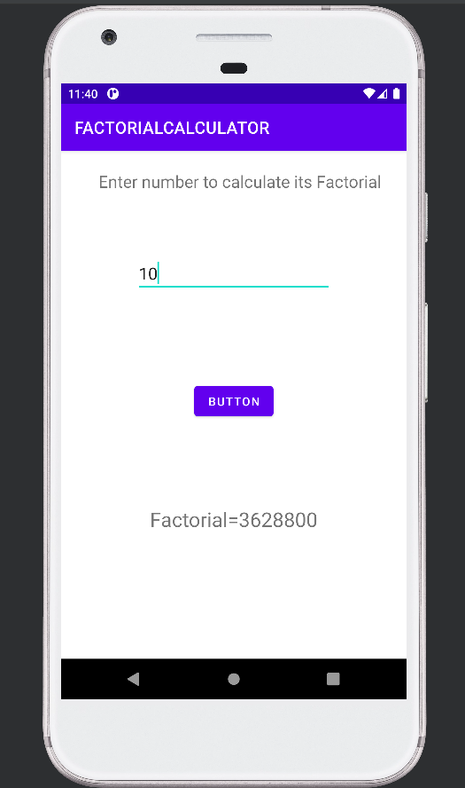

# Factorial Calculator Android App

[](https://github.com/Rishichamp/FACTORIALCALCULATOR/actions/workflows/build.yml)

This Android application calculates the **factorial of a number** entered by the user.

The project is developed using **Java and Android Studio** and demonstrates how to perform mathematical computations and display results in an Android application with a simple and user-friendly interface.

---

## Purpose

This project was created as a learning exercise to understand how to build a simple **Android application** that performs factorial calculations.

It demonstrates how to:

- Take numeric input from the user
- Perform mathematical computations in Java
- Display results dynamically in an Android interface
- Design a basic Android UI using XML layouts

---

## Features

- Calculate factorial of a number
- Simple and clean user interface
- Instant result display
- Easy user input handling
- Mathematical logic implemented using Java

---

## Technologies Used

- Java
- Android Studio
- Android SDK
- XML Layouts

---

## Project Structure

Main components of the project:

- `MainActivity.java` → Handles user input and factorial calculation logic  
- `activity_main.xml` → Defines the user interface layout of the application  

---

## How the App Works

1. The user enters a number in the input field.
2. The application calculates the factorial of the number.
3. The computed result is displayed on the screen.

Example:

```
Input: 5  
Output: 120
```

---

## Screenshots

<p align="center">
  
  
  
</p>

---

## 2026 update

- **Tooling:** upgraded from Gradle 7.3 / AGP 7.2 (which don't run on the JDK 21 in current Android Studio) to Gradle 8.11.1, AGP 8.7.3, compileSdk 35 / targetSdk 34, Java 17 and current AndroidX libraries.
- Factorial used `int`, so every answer from 13! up was wrong; it now uses `BigInteger` and is exact up to 100!.
- A large input such as 999999999 froze the app; it now shows a clear limit message.
- The empty-field message was set on a hidden view, so it never appeared.
- The result box wraps long answers; the button reads **Find factorial**.
- **Tests:** 3 unit tests and 3 on-device UI tests, all passing on an Android 11 emulator, plus a 2,000-event monkey stress test with no crashes. GitHub Actions builds, unit-tests and lints the app on every push.

## Author

Rishi Singh
